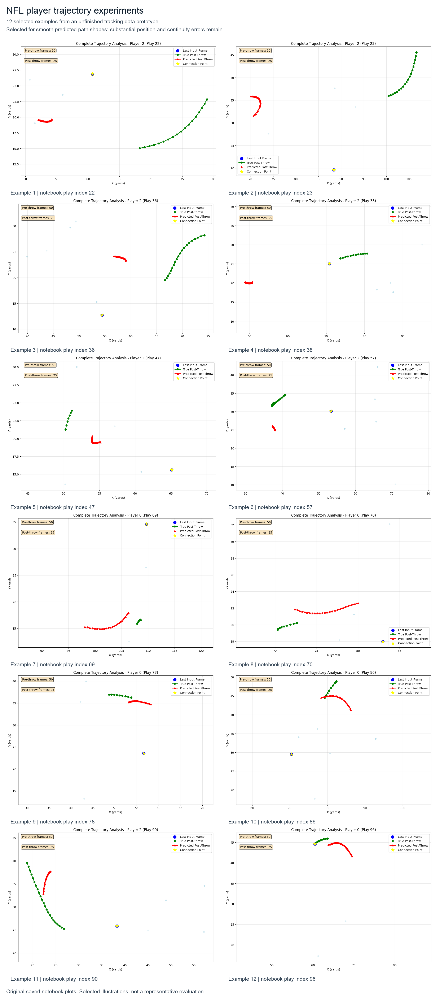

# NFL player trajectory experiments

An unfinished exploration of player movement prediction using tracking data from the NFL Big Data Bowl 2026. I experimented with temporal transformers and graph neural networks, generated predicted paths, and compared them visually with recorded movement.

*Selected examples from the prototype: red shows predicted movement and green shows recorded movement. These examples were selected for smooth predicted path shapes and proximity to recorded movement, not prediction accuracy. Position and continuity errors remain; this is not a representative evaluation or a finished competition solution. Click the image to view it at full resolution.*

## Full trajectory gallery

[Browse the full gallery source](gallery/index.html), or download this repository and open `gallery/index.html` in your browser to view all **420 saved plots** across three notebook versions. The gallery includes downloadable notebooks and full-resolution images. The original 80 transformer plots also appear in the expanded version.

GitHub displays HTML source rather than rendering the gallery directly. The [12-example overview](assets/trajectory-examples.png) above can be viewed directly on GitHub.

## Project context

This was an exploration of spatial and temporal relationships in sports. It uses structured player-tracking data. My related interest in video-language models is in learning about player movement directly from match footage and using it to explain tactically meaningful sequences.

## Notebooks

- [`experiments/data_preparation_with_trajectory_plots.ipynb`](experiments/data_preparation_with_trajectory_plots.ipynb): the later experimental notebook with 260 saved plots, including the 12 examples above.
- [`data_preparation.ipynb`](data_preparation.ipynb): the original data preparation and transformer/GNN experiments, with saved transformer plots.
- [`claude_try.ipynb`](claude_try.ipynb): the October 24, 2025 experiment with precomputed adjacency matrices. Saved logs report a best validation loss of 0.14220 on its normalized-coordinate objective; this is not a distance in yards or a leaderboard score.
- [`seq2seqgnn.ipynb`](seq2seqgnn.ipynb): sequence-to-sequence graph model experiments.
- [`eda.ipynb`](eda.ipynb): initial data exploration.

## Viewing and running

The image and saved notebook plots can be viewed without training. To explore the code locally, install Jupyter, PyTorch, NumPy, pandas, scikit-learn, and matplotlib. Obtain the NFL Big Data Bowl 2026 prediction data separately through Kaggle and check each notebook's local data paths before running it.

These are experimental notebooks, not a packaged or fully reproducible pipeline. The repository excludes datasets, model weights, and generated submission files. The notebooks have not been rerun for this presentation.

## Image provenance

The image combines unchanged saved plots from the later `data_preparation.ipynb`, preserved locally in Git stash commit `caa468c`. The notebook play indices shown are 22, 23, 36, 38, 47, 57, 69, 70, 78, 86, 90, and 96; these are sample indices, not NFL play IDs.
